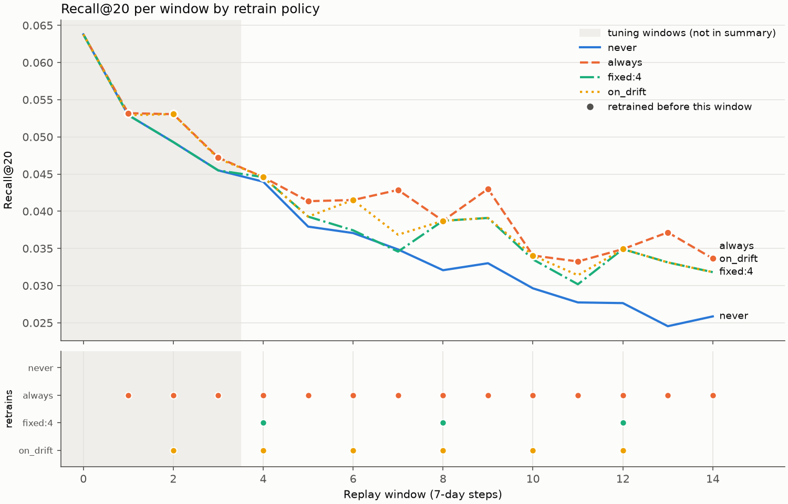

# drift-loop

A recommender system that notices when it is going stale and retrains itself.

Recommenders decay: new items arrive, tastes move, and a model trained last month
slowly stops matching this month's users. drift-loop replays historical
interactions in time order as if they were live traffic, measures that decay,
detects the drift behind it, retrains, and checks a new model before promoting it.
The question it answers with numbers is: **how much quality does each retraining
policy keep, and what does it cost?**

> **Status: M0 of 8.** The evaluation harness, a popularity baseline, drift
> statistics, retrain policies and the offline simulation of the loop are built and
> tested, on synthetic data. Real data (Yambda-50M), the two-tower model, serving,
> Kubernetes and AWS are the next milestones: see [the plan](docs/PLAN.md).

## What exists today

```bash
uv sync
make demo        # about 20 s: replays 20 synthetic weeks under four retrain policies
make check       # lint, format, types, tests
```

`make demo` writes `runs/demo/` with a per-window results table, a summary and this chart:



On this synthetic run (settings in [`configs/synthetic-demo.yaml`](configs/synthetic-demo.yaml),
popularity baseline, 11 scored one-week windows after 4 tuning windows):

| Policy | Mean recall@20 | Retrains | Share of the possible gain kept | Share of the maximum cost |
|---|---|---|---|---|
| `never` (frozen model) | 0.0322 | 0 | 0% | 0% |
| `fixed:4` (every 4 windows) | 0.0361 | 3 | 61% | 27% |
| `on_drift` | 0.0368 | 5 | 72% | 45% |
| `always` (every window) | 0.0386 | 11 | 100% | 100% |

What this does and does not show:

- It shows the harness works end to end and that a frozen model falls behind.
- It is **synthetic data and a trivial model**. The numbers say nothing about real
  recommenders; M1 repeats the experiment on real data.
- Drift-triggered retraining is **not** better than a plain schedule here. The
  synthetic drift is smooth, so the trigger fires at a steady rhythm and behaves
  like a two-window schedule. Whether a trigger earns its keep on real, burstier
  data is one of the things the project is set up to find out.
- Recall falls over time for every policy, including `always`. That is the
  protocol, not staleness: ground truth is items new to each user, and those get
  harder to hit as histories grow. Compare policies at the same window.

## How it is evaluated

One rule: **at simulated time t, nothing with a timestamp >= t exists.** Models are
always asked about what happens next, never about a shuffled sample of what they
have already seen. The full protocol, including what it cannot tell you, is in
[docs/EVALUATION.md](docs/EVALUATION.md). The tests include a leakage canary that
fails if any step of the loop reads past the simulated time.

## Where things are

| | |
|---|---|
| [docs/PLAN.md](docs/PLAN.md) | Milestones, tasks, acceptance criteria |
| [docs/EVALUATION.md](docs/EVALUATION.md) | The replay protocol, metrics, drift signals, promotion gate |
| [docs/ARCHITECTURE.md](docs/ARCHITECTURE.md) | Package layout, contracts, technology choices |
| [docs/CONCEPTS.md](docs/CONCEPTS.md) | Background: recommenders, drift, retraining, safe rollout |
| [docs/DATASET.md](docs/DATASET.md) | Yambda-50M: why, schema mapping, open questions |
| [docs/DECISIONS.md](docs/DECISIONS.md) | Decision log |
| [docs/COSTS.md](docs/COSTS.md) | AWS budget and guardrails |

## How it is built

Planned and reviewed with Claude as lead, implemented by sub-agents working from
written briefs ([docs/briefs/](docs/briefs/)), with an independent review before
each merge. The workflow is described in [CLAUDE.md](CLAUDE.md). Design decisions
are recorded in the decision log.

## Licence

MIT. The Yambda dataset is not redistributed here; see [docs/DATASET.md](docs/DATASET.md).
